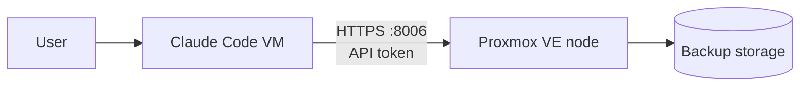
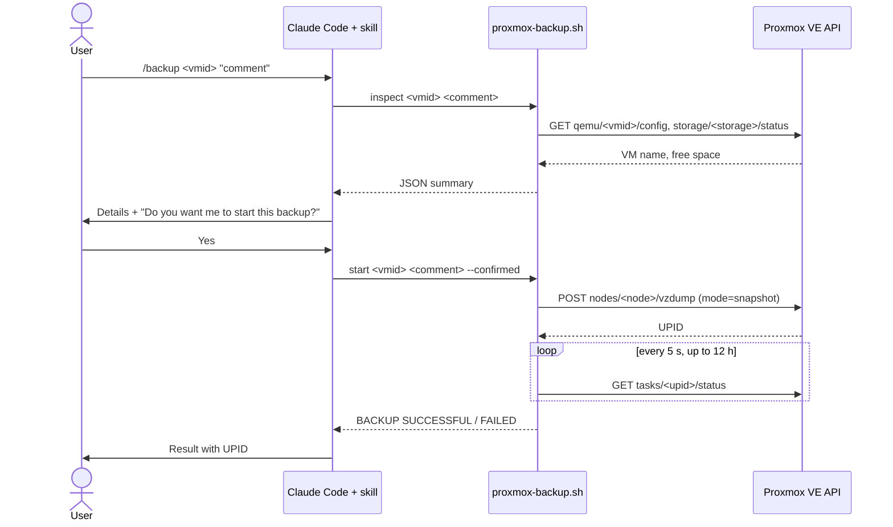

# Proxmox Claude backup: topology

How the [Proxmox VM backup integration](README.md) is laid out on the Claude Code VM, and how a request flows through it.

## Client filesystem

```text
~/
├── .config/proxmox/backup.env          API address, node, storage, token (600)
├── .local/bin/proxmox-backup.sh        Validation, API calls, task monitoring (700)
└── .claude/skills/backup/SKILL.md      /backup command and confirmation workflow
```

| File | Role |
|---|---|
| `backup.env` | Connection settings and token. Stays on the VM only. |
| `proxmox-backup.sh` | The only component that talks to the Proxmox API. Supports `inspect` and `start ... --confirmed`. |
| `SKILL.md` | Tells Claude Code how and when to run the script. Never calls the API itself. |

## Network



## Execution flow



## API endpoints used

| Method | Path | Purpose |
|---|---|---|
| GET | `/nodes/<node>/qemu/<vmid>/config` | Check the VM exists, read its name |
| GET | `/nodes/<node>/storage/<storage>/status` | Check the storage is active, read free space |
| POST | `/nodes/<node>/vzdump` | Start the snapshot backup with a notes template |
| GET | `/nodes/<node>/tasks/<upid>/status` | Monitor the task |
