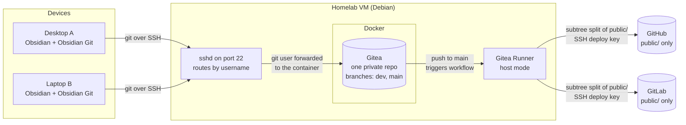
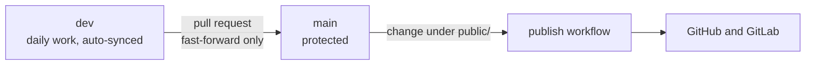

# Self-hosted Obsidian documentation with selective publishing

Notes live in one private Git repo on a self-hosted Gitea server. Laptops sync to it over SSH. Only the `public/` folder is ever published to GitHub and GitLab, and only after a reviewed merge.

## Architecture



## How a change travels



1. Devices commit to `dev` automatically through the Obsidian Git plugin.
2. When notes are ready to publish, a pull request merges `dev` into `main`. Nothing can be pushed to `main` directly.
3. A push to `main` that changes something under `public/` starts the publish workflow.
4. The workflow extracts the history of `public/` only and force-pushes it to the public repos.

## Repository layout

```
vault/                single private repo, branches: dev (default), main (protected)
├── .obsidian/        shared settings, themes and plugins (per-device state ignored)
├── private/          never published
└── public/           the only folder that is published
```

A new machine only needs an SSH key and a `git clone`. Obsidian opens already configured.

## Components

|Component|Role|
|---|---|
|Gitea (Docker)|Private hub. Hosts the repo, branch protection, pull requests and Actions.|
|Host sshd|Keeps port 22 for normal logins. Git connections from the `git` user are forwarded into the Gitea container.|
|Gitea Runner|Runs the publish workflow directly on the VM (host mode, unprivileged user, no Docker socket).|
|SSH deploy keys|One key per public repo, with write access to that repo only. They don't expire.|
|Obsidian Git plugin|Pulls on startup and commits and pushes on an interval. Its settings travel with the repo.|

## Design decisions

- **Allowlist, not denylist.** Only what sits in `public/` can be published. Forgetting an ignore rule can't leak a private note.
- **One repo, no push mirrors.** A Gitea push mirror would send every folder and branch. The workflow pushes only the extracted `public/` history.
- **Protected `main`.** The pull request is the review step before anything becomes public.
- **Scoped credentials.** Each deploy key works on a single repository, and no tokens are involved, so nothing needs renewing.
- **Everything on one data disk.** Gitea's data and the runner's files sit under one directory on a separate disk, so a single backup covers them.

## Limitations

- Public notes can't link to private ones, because those links would be dead on GitHub and GitLab.
- Anything placed inside `public/` is published. Nothing in this design can detect a secret in a public note.
- The runner executes workflows without container isolation, so only trusted accounts should be able to change workflow files.
- Mobile isn't covered.